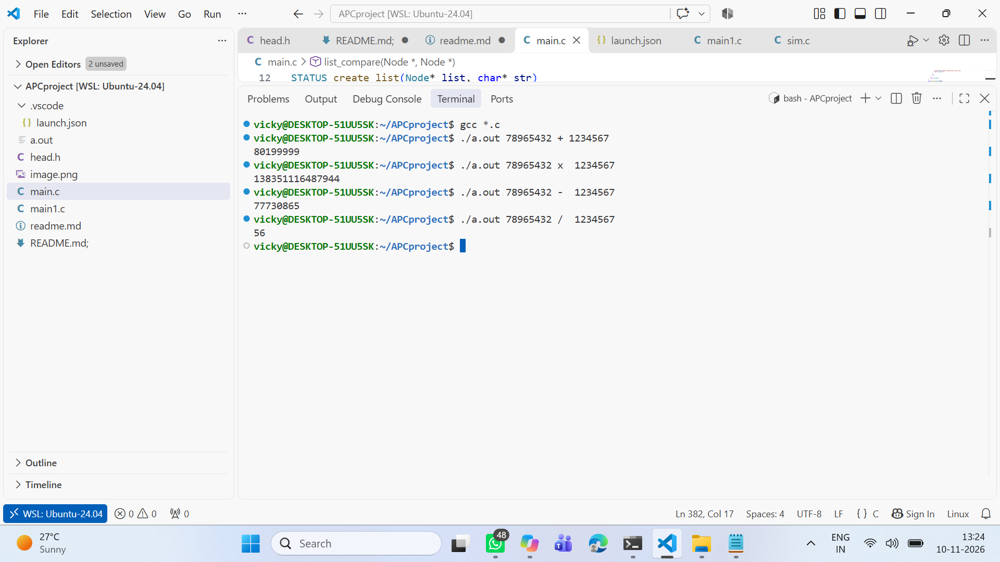

🚀 Arbitrary Precision Calculator (APC)

A C-based Arbitrary Precision Calculator using Doubly Linked Lists to perform arithmetic operations on large numbers beyond the limits of standard C data types.

---

📌 Project Overview

The Arbitrary Precision Calculator (APC) is a command-line application developed using the C programming language.

It performs arithmetic operations on large integers without depending on standard integer data types such as "int", "long", or "long long" to store the complete number.

The project uses a Doubly Linked List (DLL) to store individual digits of a number in separate nodes and processes them to perform arithmetic operations.

✨ Features

- ➕ Addition of large numbers
- ➖ Subtraction of large numbers
- ✖️ Multiplication of large numbers
- ➗ Division of large numbers
- 🔗 Doubly Linked List implementation
- 💾 Dynamic memory allocation
- 📟 Command-line argument processing
- 🧩 Modular programming using multiple C source files

🛠️ Technologies Used

Technology| Purpose
C Programming| Core development
Doubly Linked List| Number representation
Pointers| Node traversal and manipulation
Dynamic Memory Allocation| Creating and managing nodes
GCC Compiler| Compilation
VS Code| Development environment
Ubuntu 24.04 (WSL)| Linux development environment

🧠 Data Structure

Doubly Linked List

Each digit of a large number is stored in an individual node.

Each node contains:

- "data" – Stores an individual digit.
- "prev" – Points to the previous node.
- "next" – Points to the next node.

This structure supports traversal in both forward and backward directions.

⚙️ Arithmetic Operations

Operation| Operator| Description
Addition| "+"| Adds two large numbers
Subtraction| "-"| Subtracts one large number from another
Multiplication| "x"| Multiplies two large numbers
Division| "/"| Divides one number by another

📂 Project Structure

APCproject/
│
├── .vscode/
│   └── launch.json
│
├── head.h
├── main.c
├── main1.c
├── README.md
└── apc-output.png

🚀 How to Compile and Run

1. Clone the repository

git clone YOUR_GITHUB_REPOSITORY_URL

2. Navigate to the project directory

cd APCproject

3. Compile the source files

gcc *.c -o apc

4. Execute the program

Addition:

./apc 123456 234567 +

Subtraction:

./apc 500000 123456 -

Multiplication:

./apc 12345 6789 x

Division:

./apc 100 7 /

The program accepts two numbers and an arithmetic operator through command-line arguments.

📸 Project Output

The following screenshot demonstrates the execution of the APC program.

📚 Key Learning Outcomes

Through this project, I gained practical experience in:

- Implementing Doubly Linked Lists in C.
- Understanding pointers and dynamic memory allocation.
- Performing arithmetic operations using linked data structures.
- Handling command-line arguments ("argc" and "argv").
- Managing multiple C source files and header files.
- Developing modular and reusable C functions.
- Debugging and testing real-world programming logic.

🔮 Future Enhancements

- Improve error handling and input validation.
- Handle negative numbers and additional edge cases.
- Optimize arithmetic algorithms.
- Improve memory management and performance.

👨‍💻 Author

Vikas HK

Electronics and Communication Engineering

Interests: Embedded Systems | C Programming | Firmware Development

---

⭐ If you find this project interesting, feel free to explore the source code and share your feedback.